<div align="center">

# Sohan Dhungel

**Software developer from Kathmandu. Ships Android apps and games, then makes the portfolio playable.**

[sohandhungel.com.np](https://sohandhungel.com.np) ·
[Veritas Studios](https://play.google.com/store/apps/dev?id=5629311408995814555) ·
[Mad Axe Studios](https://play.google.com/store/apps/dev?id=6116371801298254722) ·
[LinkedIn](https://www.linkedin.com/in/sohan-dhungel-a9ab31329)


<br />

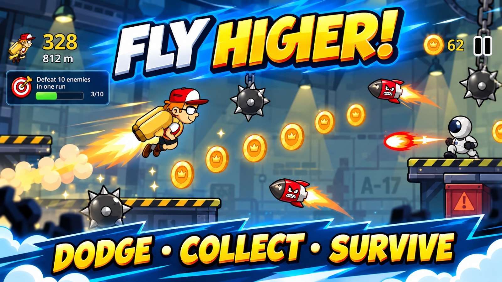
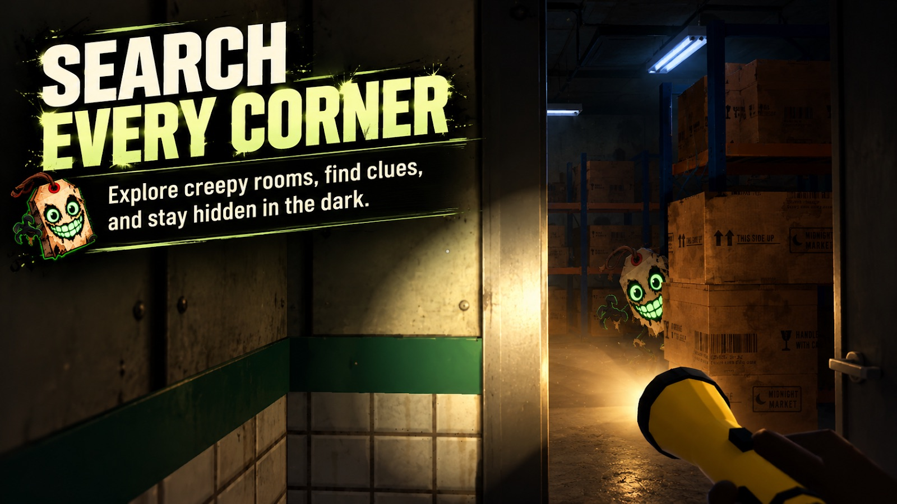
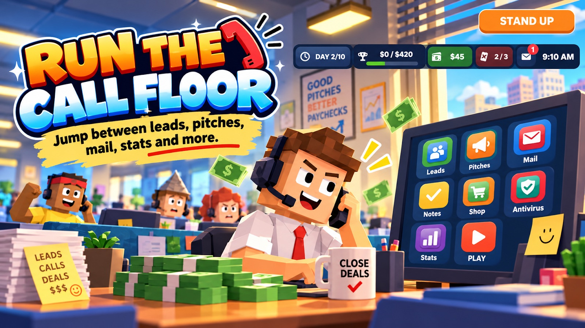

</div>

---

## Don't just read it. Play it.

The Playground section runs five small games and tools right in the page. Each
one is a pocket version of something real on Google Play.

| | Game | What you do |
| --- | --- | --- |
| 🚀 | **Jetpack Max** | Hold to fly, dodge zappers, grab coins. It speeds up. |
| 🔤 | **Daily Word** | Guess the five-letter word in six tries. Stuck? Take a clue. |
| 🔢 | **Merge 1024** | Slide, merge, push one tile to 1024. Keys, WASD, swipe or the pad. |
| ➡️ | **Arrow Escape** | Tap arrows off the board. Every board is generated solvable. |
| 🎨 | **Palette lab** | Pick a hue and recolour the whole site, with live WCAG contrast. |

Every game draws from the same colour tokens as the page, so they all work in
light mode, dark mode, and whatever colour Palette lab paints the site.

## Shipped on Google Play

<table>
<tr>
<td align="center">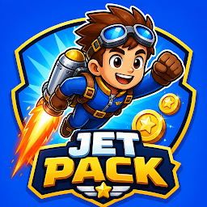<br /><sub>Jetpack Max</sub></td>
<td align="center">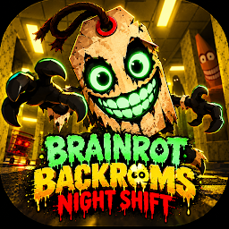<br /><sub>Brainrot Night Shift</sub></td>
<td align="center">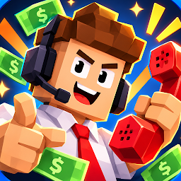<br /><sub>Scam with Friends</sub></td>
<td align="center">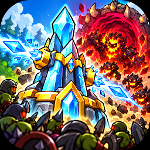<br /><sub>Realm Guard</sub></td>
<td align="center"><br /><sub>Daily Word</sub></td>
<td align="center">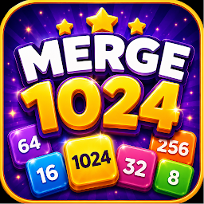<br /><sub>Merge 1024</sub></td>
</tr>
<tr>
<td align="center"><br /><sub>Subscription Guard</sub></td>
<td align="center">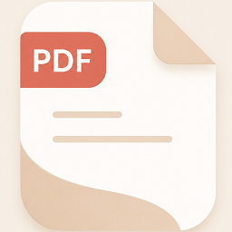<br /><sub>Veritas PDF</sub></td>
<td align="center"><br /><sub>Grocressy</sub></td>
<td align="center"><br /><sub>ColorJoy</sub></td>
<td align="center">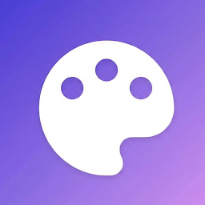<br /><sub>HuePilot</sub></td>
<td align="center">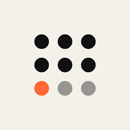<br /><sub>Year Progress</sub></td>
</tr>
</table>

Games are built in **Godot 4** and **Unity**. Apps are mostly **Flutter**.
Two studios: **Veritas Studios** for utilities and kids apps, **Mad Axe Studios**
for games.

## Run it

```bash
npm install
npm run dev      # http://localhost:3000
npm run build    # production build
npm run lint     # eslint
npx tsc --noEmit # types
```

## Change the content

No CMS, no database. The whole page reads from four typed files.

| File | Holds |
| --- | --- |
| `src/data/site.ts` | Name, contact, socials, experience, education, the journey timeline |
| `src/data/projects.ts` | Every project, its studio, Play link, icon, screenshots, and the two studio links |
| `src/data/skills.ts` | The Toolkit section, grouped |
| `src/data/demos.ts` | Demo website links and the "want a website" pitch |

**Adding an app or game:** drop `<slug>-icon.png` and `<slug>-1.jpg` ... `-4.jpg`
into `public/apps/`, add an entry to `projects.ts`, and set `landscape: true` if
the screenshots are wide. Counts, filters, the studio panels and the app ribbon
all update on their own.

The contact form posts to Formspree via `formspreeId` in `src/data/site.ts`.

## The CV

`public/sohan-dhungel-cv.pdf` is generated from `scripts/cv.html`, so edit the
HTML, not the PDF. Print it from Chrome with background graphics on, A4, default
margins. It is tuned to fit exactly one page.

<div align="center">
<sub>Built in Kathmandu. Tap, swipe, or hold Space.</sub>
</div>
